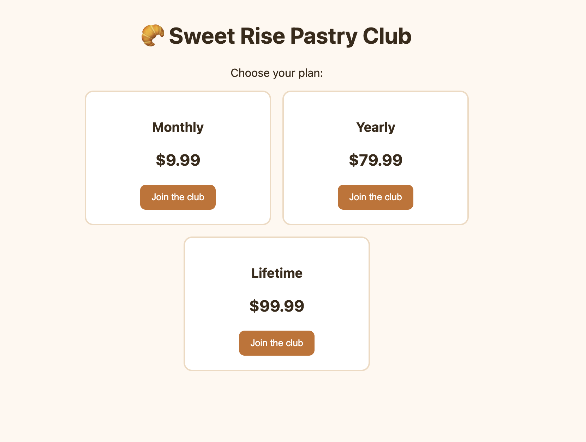
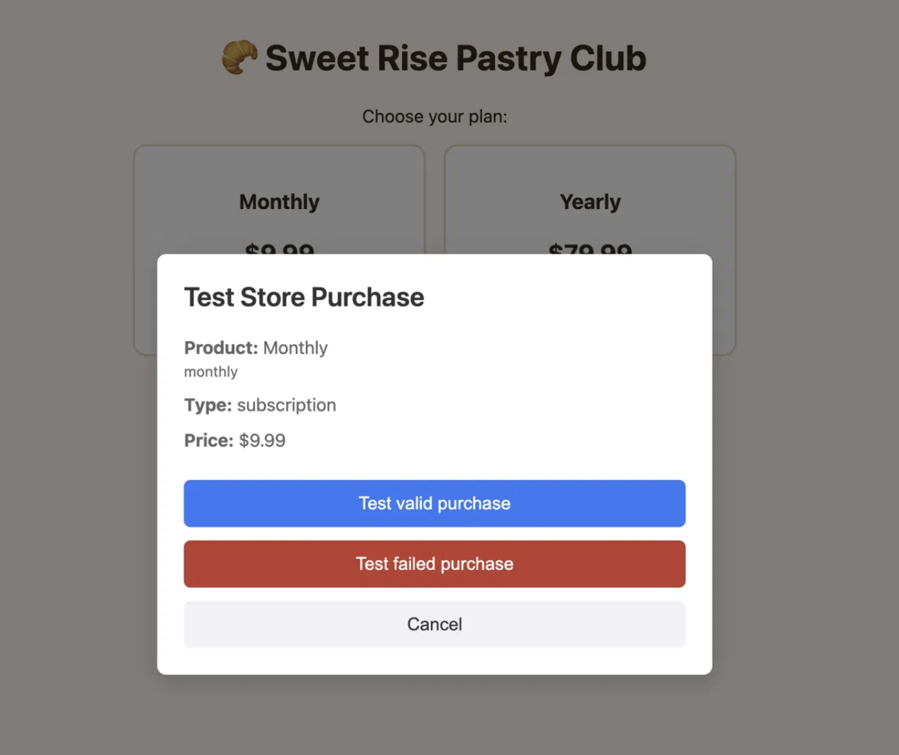
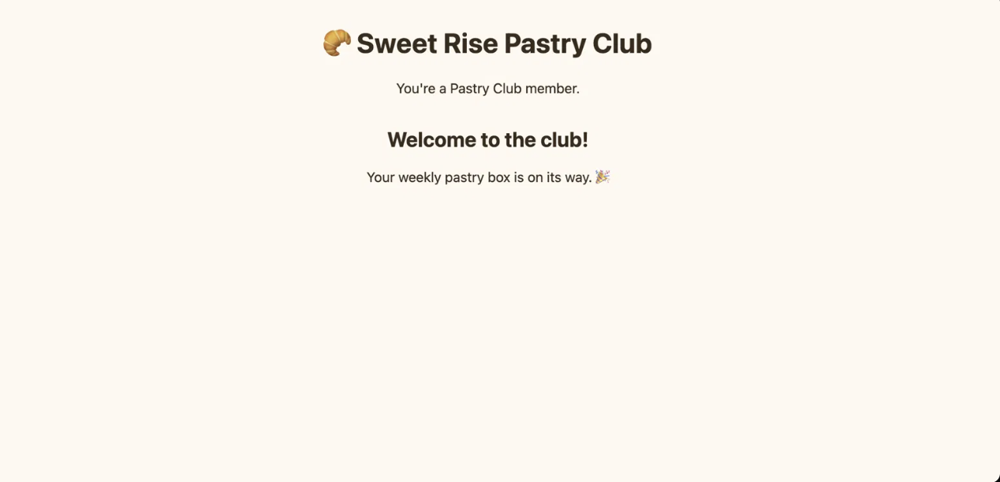
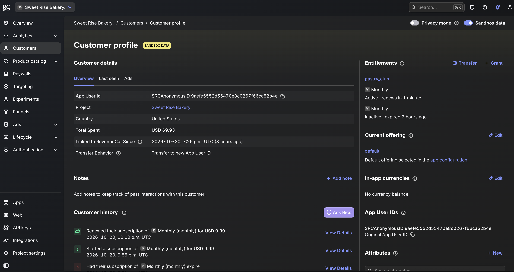

# 🥐 Sweet Rise Pastry Club

A small subscription paywall for a fictional bakery, built to learn [RevenueCat](https://www.revenuecat.com/) hands-on using the **RevenueCat Web SDK** (`@revenuecat/purchases-js`) and TypeScript.

Sweet Rise Bakery is the same fictional business from my [ReadMe developer hub](#) project, so this demo picks up where that API story left off: now the bakery sells a subscription.

## What it does

- Loads the **current offering** from RevenueCat and renders each package (Monthly, Yearly, Lifetime) with its price
- Starts a purchase with `purchase({ rcPackage })` using RevenueCat's **Test Store**, so there is no Stripe or app store setup
- Checks the `pastry_club` **entitlement** in `customerInfo` and unlocks member content
- Remembers the anonymous customer across reloads, so members stay members
- Handles a cancelled checkout quietly and shows a friendly message when a purchase fails

## Screenshots

| Choose a plan                          | Test checkout                                      |
| -------------------------------------- | -------------------------------------------------- |
|  |  |

| Member view                                  | RevenueCat customer profile                      |
| -------------------------------------------- | ------------------------------------------------ |
|  |  |

## How it works

```
Offerings → Packages → Purchase → CustomerInfo → Entitlement check
```

1. `Purchases.configure({ apiKey, appUserId })` sets up the SDK with an anonymous App User ID saved in `localStorage`.
2. `getCustomerInfo()` checks whether the customer already has the `pastry_club` entitlement.
3. If not, `getOfferings()` returns the current offering, and the page renders one card per package.
4. Clicking **Join the club** calls `purchase({ rcPackage })`. The returned `customerInfo` is checked again, and the member view appears.

## Setup

1. Create a RevenueCat project and add products (monthly, yearly, lifetime).
2. Create an entitlement with the identifier `pastry_club` and attach all products.
3. Create an offering, add the packages, and set it as **current**.
4. Copy your Test Store API key into `.env`:
   ```
   VITE_RC_API_KEY=your_test_key_here
   ```
5. Install and run:
   ```bash
   npm install
   npm run dev
   ```
6. Click **Join the club** and choose **Test valid purchase**.

To reset and test again as a new customer, run this in the browser console:

```js
localStorage.removeItem("rc_app_user_id");
location.reload();
```

## What I learned

- **Entitlements separate access from products.** The app only asks "does this customer have `pastry_club`?" Monthly, yearly and lifetime purchases all unlock the same thing, so pricing can change without touching access logic.
- **Offerings let you change what customers see without shipping code.** Adding or reordering packages in the dashboard updates the page on the next load.
- **Test Store makes the first integration fast.** I could test valid, failed and cancelled purchases without setting up Stripe or an app store account.
- **Sandbox subscriptions renew on an accelerated schedule** (my monthly plan showed "renews in 3 minutes"), which makes it practical to test renewal behavior in one sitting.
- **The customer profile is a great debugging tool.** It shows the App User ID, active entitlement, offering and full purchase history in one place.

## Built with

TypeScript · Vite · RevenueCat Web SDK · RevenueCat Test Store
